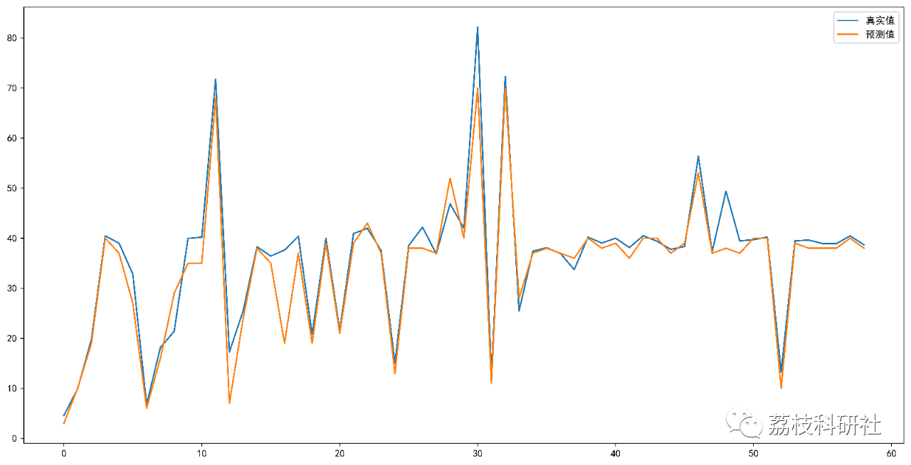

# Power Load Forecasting Based on KNN (K-Nearest Neighbors) (Python Code Implementation)

💥💥💥💞💞💞💞 Welcome to this blog❤️❤️❤️💥💥💥
🏆 Bloggers' Advantages: 🌞🌞🌞 The content of the blog strives to be rigorous in thought and clear in logic, for the convenience of readers.
​  
⛳️ Mantra: The journey of a hundred miles is half done in the last ninety.
🎁Column Directory:
🌈🌈🌈🌟🌟🌟Intelligent algorithms for electrical code and their application in path planning, neural network prediction optimization scheduling, image processing, workshop scheduling, signal processing, romantic her, my philosophical thoughts, mathematical modeling, complete code matters.  
💥1 Recent Neighbors (k-Nearest Neighbor) Algorithm
📋1.1 Basic Definition
The k-Nearest Neighbors (k-NN) algorithm is a relatively simple machine learning algorithm. It classifies by measuring the distance between different feature values. Its idea is very simple: if a sample has the majority of its nearest neighbors (most similar samples) in one category, then the sample belongs to that category as well. The first letter k can be lowercase, indicating the number of externally defined neighbors.
In summary, it is to let the machine itself according to the distance of each point, the closer the distance is one category.
📋1.2 Algorithm Principles
The core idea of the KNN algorithm is to determine the category of an unlabeled sample based on the votes cast by its k nearest neighbors.
Specifically, suppose we have a labeled dataset. At this point, there is an unlabeled data sample, and our task is to predict the category of this data sample. The principle behind K-Nearest Neighbors (KNN) is to calculate the distance between the unlabeled sample and each sample in the dataset, selecting the k samples closest. The category of the unlabeled sample is then determined by voting among these k closest samples.
Assume X_test is the sample to be labeled, and X_train is the dataset that has been labeled. The pseudocode of the algorithm principle is as follows:
Iterate through all samples in X_train, calculate the distance between each sample and X_test, and save the distances in Distance array.
Sort the Distance array and select the k nearest points, denoted as X_knn.
In X_knn, count the number of samples for each class, i.e., how many samples are in class0 in X_knn, how many samples are in class1 in X_knn, etc.  
The category of the labeled sample is the one with the most samples in X_knn.  
📚2 Understanding the sklearn.neighbors.KNeighborsClassifier() function
class sklearn.neighbors.KNeighborsClassifier(n_neighbors=5, weights=’uniform’, \n                      algorithm=’auto’, leaf_size=30, \n                      p=2, metric=’minkowski’, \n                      metric_params=None, \n                      n_jobs=None, **kwargs)\n​\n  
📃2.2 Explanation
n_neighbors : int,  optional (default = 5) The number of neighbors used by k-neighbors queries by default. The value of k in K-NN. Select the k nearest points. weights: str or callable. Optional (default is 'uniform') The default is 'uniform'. Parameters can be uniform. distance,  It can also be a user-defined function. Uniform is equal weight. All the weights of neighboring points are equal. Distance is an uneven weight. Points closer to the origin have greater impact than points farther away. User-defined functions. Array of reception distances. Return a set of weights with the same dimensions.
Algorithm: {'auto', 'ball_tree', 'kd_tree', 'brute'}. Optionally, the user can specify the search algorithm 'ball_tree', 'kd_tree', or 'brute' for search. The 'brute' method is a brute-force search, which means linear scanning. When the training set is large, this approach is computationally intensive. The 'kd_tree' constructs a tree-like data structure to store data for fast retrieval. In other words, the kd tree is a binary tree within the data structure.
leaf_size : int, optional (default value = 30)
The default value is 30, which represents the size of the constructed kd tree and ball tree. The setting of this value affects the speed of tree construction and search, as well as the memory required for storing the tree. It should be selected based on the nature of the problem.
p: Integer, optional (default=2) distance metric formula. In the previous section, we used the Euclidean distance formula for distance measurement. Besides, there are other metrics such as Manhattan distance. This parameter is defaulted to 2, meaning that the default distance metric is the Euclidean distance formula. It can also be set to 1, using the Manhattan distance formula for distance measurement.
metric: String or callable, default='minkowski' for distance measurement, default metric is minkowski, which means the Euclidean distance (Euclidean measure).
metric_params: dict, optional (default=None) other key parameters of the distance formula, this can be ignored and use the default None.
n_jobs: int or None, optional (default=None) parallel processing setting. Default is 1, number of cores for near-neighbor search parallel work. If -1, then all CPU cores are used for parallel work.
🎉3 Based on KNN (K-Nearest Neighbors) for Electricity Consumption Forecasting (Python Code Implementation)
📝3.1 Run Results
Evaluation parameters:
Original data    Predicted data   Mean squared error   Mean root squared error   Mean absolute error\n0    4.566667     3  17.635932  4.199516  2.476836\n1    9.900000    10  17.635932  4.199516  2.476836\n2   19.833332    19  17.635932  4.199516  2.476836\n3   40.466667    40  17.635932  4.199516  2.476836\n4   39.000000    37  17.635932  4.199516  2.476836\n5   32.833332    27  17.635932  4.199516  2.476836\n6    6.766667     6  17.635932  4.199516  2.476836\n7   18.166668    16  17.635932  4.199516  2.476836\n8   21.400002    29  17.635932  4.199516  2.476836\n9   39.966667    35  17.635932  4.199516  2.476836\n10  40.200000    35  17.635932  4.199516  2.476836\n11  71.800000    68  17.635932  4.199516  2.476836\n12  17.233334     7  17.635932  4.199516  2.476836\n13  25.500000    24  17.635932  4.199516  2.476836\n14  38.300000    38  17.635932  4.199516  2.476836\n15  36.433334    35  17.635932  4.199516  2.476836\n16  37.633335    19  17.635932  4.199516  2.476836\n17  40.400000    37  17.635932  4.199516  2.476836\n18  20.766666    19  17.635932  4.199516  2.476836\n19  40.000000    39  17.635932  4.199516  2.476836\n20  21.599998    21  17.635932  4.199516  2.476836\n21  40.933334    39  17.635932  4.199516  2.476836\n22  41.966667    43  17.635932  4.199516  2.476836\n23  37.533333    37  17.635932  4.199516  2.476836\n24  15.033334    13  17.635932  4.199516  2.476836\n25  38.533333    38  17.635932  4.199516  2.476836\n26  42.200000    38  17.635932  4.199516  2.476836\n27  36.866665    37  17.635932  4.199516  2.476836\n28  46.866670    52  17.635932  4.199516  2.476836\n29  42.000000    40  17.635932  4.199516  2.476836\n30  82.233330    70  17.635932  4.199516  2.476836\n31  12.166667    11  17.635932  4.199516  2.476836\n32  72.333336    70  17.635932  4.199516  2.476836\n33  25.466667    28  17.635932  4.199516  2.476836\n34  37.400000    37  17.635932  4.199516  2.476836\n35  38.100000    38  17.635932  4.199516  2.476836\n36  36.933334    37  17.635932  4.199516  2.476836\n37  33.733334    36  17.635932  4.199516  2.476836\n38  40.200000    40  17.635932  4.199516  2.476836\n39  39.033333    38  17.635932  4.199516  2.476836\n40  40.000000    39  17.635932  4.199516  2.476836\n41  38.133335    36  17.635932  4.199516  2.476836\n42  40.500000    40  17.635932  4.199516  2.476836\n43  39.400000    40  17.635932  4.199516  2.476836\n44  37.766666    37  17.635932  4.199516  2.476836\n45  38.333336    39  17.635932  4.199516  2.476836\n46  56.366670    53  17.635932  4.199516  2.476836\n47  37.300000    37  17.635932  4.199516  2.476836\n48  49.400000    38  17.635932  4.199516  2.476836\n49  39.466667    37  17.635932  4.199516  2.476836\n50  39.700000    40  17.635932  4.199516  2.476836\n51  40.233334    40  17.635932  4.199516  2.476836\n52  13.266666    10  17.635932  4.199516  2.476836\n53  39.466667    39  17.635932  4.199516  2.476836\n54  39.633335    38  17.635932  4.199516  2.476836\n55  38.933334    38  17.635932  4.199516  2.476836\n56  38.900000    38  17.635932  4.199516  2.476836\n57  40.466667    40  17.635932  4.199516  2.476836\n58  38.700000    38  17.635932  4.199516  2.476836\n​\nProcess finished with exit code 0\n  
📝3.2 Python Code and Data  
Click the "Read More" button at the bottom left of this article  
Or reply with the keyword: Predicting Electricity Load Based on KNN (K-Nearest Neighbors)  
👨‍💻4 Final Thoughts

## Images

<!-- PAYMENT_BLOCK -->

## Get this dataset

- Payment link (Stripe): [Buy now](https://buy.stripe.com/3cs8yP7sY87d0vu9AB)
- Payment QR code: 

<!-- /PAYMENT_BLOCK -->
